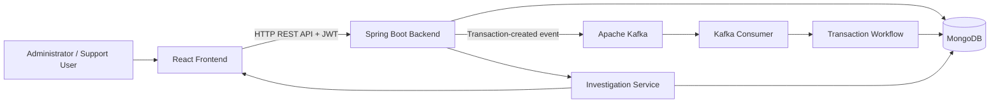

# Txnora — Transaction Lifecycle Monitoring

**Txnora** is a full-stack transaction monitoring application built to make transaction processing easier to inspect and investigate. It provides a web interface for viewing transaction records and statuses, reviewing transaction history and recorded risk-evaluation results, and managing application users through an administrator workflow.

**Repository:** [IshaParihariya/Txnora](https://github.com/IshaParihariya/Txnora)

## Overview

Transaction processing involves multiple stages, and a final status alone may not explain what happened along the way. Txnora stores transaction status history and risk-evaluation results so a support user can inspect a transaction's recorded lifecycle and, where a failed transaction has a recorded rejected risk result, view the associated reason.

The project combines a React frontend with a Java Spring Boot backend, MongoDB persistence, and an Apache Kafka event-driven workflow.

## Key Features

### Transaction Monitoring
- View transaction records and their current statuses.
- Search transaction records by transaction ID, user ID, or merchant ID.
- Filter transactions by status.
- Review transaction details, including amount, currency, user, merchant, timestamps, and status.

### Transaction Investigation
- Investigate a transaction using its transaction ID.
- Retrieve transaction details, status-history entries, and recorded risk-evaluation results.
- Display a recorded risk-rejection reason for a failed transaction when one is available.
- Review the recorded status timeline rather than relying only on the current status.

### Transaction Workflow and Risk Checks
- Create transactions through the backend API.
- Persist transaction records and their initial history entries.
- Publish transaction-created events to Kafka for workflow processing.
- Track the lifecycle through `INITIATED`, `PROCESSING`, `AUTHORIZED`, `SETTLEMENT_PENDING`, `SETTLED`, and `FAILED`.
- Apply implemented risk checks, including amount thresholds, merchant risk classification, merchant suspension, and supported-currency checks.

### Authentication and User Administration
- JWT-based login.
- Administrator and support roles.
- Administrator-facing user and invitation screens.
- Invitation acceptance with password setup.
- Account settings and change-password functionality.

### Dashboard and User Guide
- Dashboard summary and transaction overview.
- An **About & User Guide** link that opens the PDF guide in a new browser tab.

## Transaction Lifecycle

| Status | Meaning |
|---|---|
| `INITIATED` | The transaction record has been created. |
| `PROCESSING` | Processing has started. |
| `AUTHORIZED` | The transaction has passed the authorization stage. |
| `SETTLEMENT_PENDING` | The transaction has moved to the settlement stage. |
| `SETTLED` | Settlement has completed successfully. |
| `FAILED` | The transaction workflow or a risk check has resulted in a failed status. |

The backend validates status transitions and records status changes in transaction history. `SETTLED` and `FAILED` are terminal statuses in the current transition logic.

## Architecture



### Main Components

- **Frontend:** React, Vite, Tailwind CSS, React Router, Axios, and Lucide icons.
- **Backend:** Java 21, Spring Boot, Spring Web MVC, Spring Security, Spring Data MongoDB, validation, and JWT.
- **Event processing:** Apache Kafka with a producer, consumer, and transaction workflow service.
- **Database:** MongoDB for transaction and application data.
- **Invitation email integration:** Resend Java SDK.

## Technology Stack

| Area | Technologies |
|---|---|
| Frontend | React, JavaScript, Vite |
| Styling and UI | Tailwind CSS, Lucide React |
| Client-side routing | React Router |
| HTTP client | Axios |
| Backend language | Java 21 |
| Backend framework | Spring Boot 4.1.1 |
| REST API | Spring Web MVC |
| Security | Spring Security, JSON Web Tokens (JWT) |
| Persistence | Spring Data MongoDB, MongoDB |
| Event streaming | Apache Kafka, Spring Kafka |
| Email invitations | Resend Java SDK |
| Build tools | npm, Maven |
| Containerization | Docker |
| Hosting configured | Vercel for the frontend and Render for the backend |

## Risk Evaluation

The current backend includes the following risk checks:

- **Amount threshold:** Rejects a transaction when its amount exceeds `100000`.
- **Merchant risk classification:** Rejects a transaction when the merchant's risk level is not `LOW`.
- **Merchant status:** Rejects a transaction when the merchant is suspended.
- **Currency support:** The risk-evaluation service currently accepts `INR`, `USD`, `EUR`, and `GBP`.

These checks describe the implemented project logic and are not a claim that Txnora is a complete production payment-risk system.

## API Overview

The backend exposes endpoints for authentication, transaction management, investigation, and user administration. The following are the documented endpoint paths; access requirements depend on the application's security configuration.

| Method | Endpoint | Purpose |
|---|---|---|
| `POST` | `/api/auth/login` | Authenticate with email and password and obtain a JWT. |
| `GET` | `/api/auth/me` | Retrieve the authenticated user's account information, if enabled in the deployed backend. |
| `POST` | `/api/auth/change-password` | Change the authenticated user's password. |
| `POST` | `/api/create/transaction` | Create a transaction and publish a transaction-created event. |
| `GET` | `/api/transactions` | Retrieve transaction records. |
| `GET` | `/api/transactions/{id}` | Retrieve a transaction by ID. |
| `GET` | `/api/transactions/user/{userId}` | Retrieve transactions for a user ID. |
| `GET` | `/api/transactions/failed` | Retrieve failed transactions. |
| `GET` | `/api/investigations/{transactionId}` | Retrieve investigation data for a transaction. |
| `POST` | `/api/user/invite` | Send a user invitation. |
| `POST` | `/api/user/accept` | Accept an invitation and set up an account password. |
| `GET` | `/api/user/all` | Retrieve user records. |

## Repository Structure

```text
Txnora/
├── src/
│   ├── main/
│   │   ├── java/com/example/txnora/
│   │   │   ├── config/          # Kafka configuration
│   │   │   ├── controller/      # API controllers
│   │   │   ├── dto/             # Request and response objects
│   │   │   ├── enums/           # Roles, statuses, and risk rules
│   │   │   ├── event/            # Kafka event models
│   │   │   ├── model/            # Data models and history records
│   │   │   ├── repository/       # MongoDB repositories
│   │   │   ├── security/         # Authentication and JWT components
│   │   │   └── service/          # Business logic and workflow services
│   │   └── resources/
│   │       └── application.properties
│   └── test/
├── txnora-app/
│   ├── public/                   # Public assets and PDF user guide
│   └── src/
│       ├── components/           # Shared UI components
│       ├── pages/                # Application pages
│       └── services/             # API client modules
├── Dockerfile
├── pom.xml
└── README.md
```

## Run Locally

### Prerequisites

- Java 21
- Maven
- Node.js and npm
- MongoDB
- Apache Kafka

The backend requires MongoDB and Kafka to be configured and accessible. Kafka event processing also requires the configured transaction-created topic to be available.

### 1. Configure the Backend

Configure the following environment variables for your local environment:

| Variable | Purpose | Default |
|---|---|---|
| `MONGODB_URI` | MongoDB connection URI | Must be configured |
| `KAFKA_BOOTSTRAP_SERVERS` | Kafka bootstrap server address | `localhost:9092` |
| `SPRING_KAFKA_CONSUMER_GROUP_ID` | Kafka consumer group | `txnora-workflow-group` |
| `PORT` | Backend HTTP port | `8080` |

The application also uses Resend for invitation emails. Configure the credential expected by the email service before testing invitation delivery.

**Security:** Never commit database credentials, API keys, JWT secrets, or other private configuration values to GitHub.

### 2. Start the Backend

From the repository root:

```bash
mvn spring-boot:run
```

The configured default HTTP port is `8080`.

### 3. Start the Frontend

Open a second terminal:

```bash
cd txnora-app
npm install
npm run dev
```

Vite prints the local development URL in the terminal.

The frontend API client uses `VITE_API_BASE_URL` when configured; otherwise, it defaults to `http://localhost:8080`.

### 4. Sign In

Use an account that has already been provisioned or created through the invitation workflow. The application does not provide a public self-registration screen.

## Docker

A `Dockerfile` is included for building the backend with Maven and running the packaged application on a Java 21 runtime image. MongoDB, Kafka, and any required email-service credentials must be configured separately.

## Deployment

The project has been configured for frontend hosting on Vercel and backend hosting on Render.

- **Frontend:** [Txnora on Vercel](https://txnora-sigma.vercel.app)
- **Backend:** [Txnora backend on Render](https://txnora-backend.onrender.com)

Hosted service availability depends on the current deployment and environment configuration. The application requires its backend dependencies and environment variables to be configured correctly.

## Scope and Limitations

- Txnora is a transaction-monitoring and workflow project. This README does not claim integration with a real bank, payment gateway, or live money movement.
- Investigation responses rely on stored transaction history and risk-evaluation results. A recorded risk-rejection reason can be shown when an applicable rejected result exists; not every infrastructure failure is guaranteed to have a recorded explanation.
- Kafka event processing, MongoDB persistence, and the implemented risk checks are project features. This README does not claim production certification, complete observability, or a fully automated timeout detector for transactions that remain in a non-terminal state.
- No license is specified here. Add a license file only if you intend to publish the project under a particular license.

## About

Txnora was developed as a full-stack software project to explore transaction lifecycle tracking, event-driven backend processing, recorded risk evaluation, transaction investigation, and role-based application workflows.

**Source code:** [github.com/IshaParihariya/Txnora](https://github.com/IshaParihariya/Txnora)
